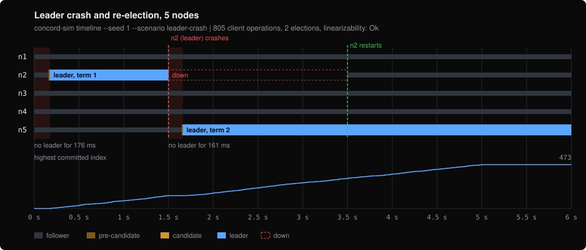

# Concord

[](https://github.com/TIENDUNG21/concord-raft-cluster/actions/workflows/ci.yml)
[](LICENSE)

<p align="center"></p>

Concord is a key-value store replicated with Raft, written in C# for .NET 8. The Raft code has no I/O of
its own, so the same code runs in an ASP.NET Core server and in a deterministic simulator where one
64-bit seed reproduces a whole run, faults included, and every history the clients observe is checked
for linearizability.



The picture is a real run, written by `concord-sim timeline --seed 1`. Five nodes and five clients. The
leader n2 crashes at 1.5 s; for 161 ms there is no leader and the commit index (bottom) stops moving;
n5 wins term 2 and the clients carry on; n2 restarts from its on-disk state at 3.5 s and rejoins as a
follower. The 805 client operations in the run were then checked and found linearizable.

```
$ dotnet run --project src/Concord.Sim -c Release -- sweep --seeds 1000
Concord simulation sweep: seeds 1..1000, 5 nodes, 12 s virtual time each, 4 workers
passed: 1000 / 1000
client operations: 1,314,193 (given up after retries: 1,592)
elections: 4,200, faults injected: 14,802, messages delivered: 13,700,365
linearizability: 1,000 histories proven linearizable, 0 inconclusive
virtual time simulated: 3.3 h in 5.2 s of wall time
```

## How the simulation works

Everything a Raft node depends on is an interface: `IClock`, `IRandomSource`, `ITransport`,
`IRaftStorage`, `IStateMachine`. `RaftNode` is driven from outside (`Step` for a message, `Tick` when
its next timer is due) and never blocks, starts a thread or reads the wall clock. That idea comes from
FoundationDB's simulation testing (Zhou et al., 2021) and is the reason a seed can mean something.

The simulator is a single-threaded event queue ordered by virtual time and insertion order. Messages
take 1 to 8 ms, with 2% delayed up to 80 ms so they arrive out of order. During the first 8 s of a 12 s
run a fault is drawn every 150 to 900 ms: a random split into two partitions, the leader isolated, a
link cut in one direction, a burst of loss and duplication, a crash, a restart, or a crash followed by
a restart a few milliseconds later. A crash throws away the node object and its state machine; its
storage survives, as a synced disk would. Then everything heals and the cluster must recover: every
client finishes its last operation and every node applies the same log prefix.

All randomness comes from one xoshiro256** generator (Blackman and Vigna, 2021) seeded through
SplitMix64 and forked per subsystem, implemented here so that a seed means the same run on any .NET
version or OS. The trace keeps a running hash of every event, and a test asserts that a seed always
produces the same hash.

When a run fails, the seed is the bug report. This is the harness catching a deliberately broken read
path (`--bug unsafe-reads` lets a leader answer reads without confirming it is still leader):

```
$ concord-sim run --seed 7 --bug unsafe-reads
seed 7: FAILED
...
history of key k0 is not linearizable:
no valid order exists; the longest legal prefix places 170 of 364 operations, ending with:
   ...
   169. [1157..1161] c103 put(k0, "c103.103") => ok nil
   170. [1159..1160] c105 put(k0, "c105.115") => ok nil
none of these can come next:
       [1166..1170] c105 get(k0) => ok "c102.111"
       ...
```

Client 105 wrote `c105.115` and then read back an older value from a node that believed it was leader
but did not have the latest writes. Without the bug, the same seed passes.

## What is checked

The invariant monitor watches every node as the run happens and stops at the first violation of
Raft's safety properties (Ongaro and Ousterhout, 2014, Figure 3):

- at most one leader per term,
- at most one vote per node per term, across restarts,
- no two nodes apply different entries at the same index,
- a newly elected leader holds every entry already applied anywhere,
- commit and apply indexes never move backwards on a node.

The linearizability checker looks at what clients saw, which is the guarantee that matters to a user.
Each operation is recorded with its call and return time and its result; an operation the client gave up
on is recorded as "never returned", meaning it may have taken effect at any point after its call, or
not at all. The checker is the Wing and Gong (1993) search with Lowe's (2017) memoization, the algorithm
behind Porcupine: walk the history in time order, try to linearize the earliest pending call against a
sequential model of a register with compare-and-set, backtrack when a return is reached whose call has
not been placed, and cache (linearized set, state) pairs so no state is explored twice. Because
linearizability is local (Herlihy and Wing, 1990), each key is checked separately. The checker has its
own tests, including histories that must be rejected: a stale read, a read of a value never written, two
compare-and-sets that both succeed, and generated histories with one observed value corrupted.

Two deliberately broken variants show the checks are not vacuous. Measured with
`concord-sim sweep --seeds 2000 --bug NAME --expect-failures`:

| Injected bug | Caught by | Failing seeds |
|---|---|---|
| `unsafe-reads`: leader reads without ReadIndex | linearizability checker | 66 of 2,000 |
| `ignore-log-votes`: votes without the log up-to-date check | invariant monitor | 531 of 2,000 |

## Running a cluster

Three nodes on one machine, one terminal each:

```bash
dotnet build -c Release
PEERS=1=http://127.0.0.1:5161,2=http://127.0.0.1:5162,3=http://127.0.0.1:5163
dotnet src/Concord.Server/bin/Release/net8.0/Concord.Server.dll --urls http://127.0.0.1:5161 --node-id 1 --peers $PEERS --data-dir .cluster/n1
dotnet src/Concord.Server/bin/Release/net8.0/Concord.Server.dll --urls http://127.0.0.1:5162 --node-id 2 --peers $PEERS --data-dir .cluster/n2
dotnet src/Concord.Server/bin/Release/net8.0/Concord.Server.dll --urls http://127.0.0.1:5163 --node-id 3 --peers $PEERS --data-dir .cluster/n3
```

A session against that cluster, with node 1 as leader. Any node accepts any request; followers answer
`307` to the leader, which `curl -L` follows with the body.

```
$ curl -si -X PUT --data 'hello' localhost:5162/kv/greeting | grep -E '^(HTTP|Location|Concord-Leader)'
HTTP/1.1 307 Temporary Redirect
Location: http://127.0.0.1:5161/kv/greeting
Concord-Leader: 1

$ curl -sL -X PUT --data 'hello' localhost:5162/kv/greeting
{"key":"greeting","index":2}
$ curl -sL localhost:5162/kv/greeting
{"key":"greeting","value":"hello","index":2}
$ curl -sL -X POST -H 'Content-Type: application/json' --data '{"expected":null,"value":"worker-1"}' localhost:5161/kv/lock/cas
{"key":"lock","swapped":true,"value":"worker-1","index":3}
$ curl -sL -X POST -H 'Content-Type: application/json' --data '{"expected":null,"value":"worker-2"}' -w ' %{http_code}' localhost:5161/kv/lock/cas
{"key":"lock","swapped":false,"value":"worker-1","index":4} 409
$ curl -sL -X DELETE localhost:5161/kv/greeting
{"key":"greeting","deleted":true,"index":5}
$ curl -sL -w ' %{http_code}' localhost:5161/kv/greeting
{"key":"greeting","value":null,"index":5} 404
```

`GET /cluster/status` shows role, term, leader, commit and apply indexes and, on the leader, each
follower's match index and replication state. Writes that send `Concord-Client-Id` and
`Concord-Sequence` headers are exactly-once: a retry with the same pair is answered from the client's
session in the state machine instead of being applied again.

`scripts/smoke.sh` runs this cluster, writes through a follower, stops the leader, waits for a new one,
checks the data, and restarts the old leader. `docker compose up` starts the same three nodes from the
Dockerfile on ports 5161 to 5163. Docker is not installed on the machine this was developed on, so the
image build and `MODE=compose scripts/smoke.sh` are verified in CI only.

## Design

Writes go through the log. Reads use ReadIndex (Ongaro, 2014, section 6.4): the leader confirms with one
heartbeat round that a majority still follows it, then serves the read once its state machine has
applied the commit index it recorded, so reads cost a round trip but no disk write and no clock
assumption. Elections use pre-vote and check-quorum, so a node returning from a partition cannot depose
a healthy leader and a cut-off leader steps down within an election timeout. Snapshots compact the log
every 1,000 applied entries (200 in the simulator, to exercise InstallSnapshot often). On disk, log
records are framed with a length and CRC-32 and fsynced before an append returns; a torn final record is
cut on restart, and any other bad record stops the node rather than silently losing acknowledged data.

[docs/ARCHITECTURE.md](docs/ARCHITECTURE.md) walks through the node, the server loop, storage, the
simulator and the checker. The decisions and their costs are in [docs/adr](docs/adr).

| Path | Contents |
|---|---|
| `src/Concord.Core` | Raft node, messages, storage interface, wire codec |
| `src/Concord.Kv` | KV state machine with client sessions, `KvService` |
| `src/Concord.Simulation` | simulator, faulty network, fault injector, invariant monitor, clients, timeline SVG |
| `src/Concord.Checker` | linearizability checker |
| `src/Concord.Sim` | `concord-sim` command line |
| `src/Concord.Server` | ASP.NET Core node, HTTP transport, file storage |

## Tests

277 xUnit tests: 77 for the Raft core (elections, pre-vote, replication, the Figure 8 commit rule,
snapshots, ReadIndex, wire codec including every truncation of a message batch), 28 for the KV layer,
97 for the checker (17 hand-written histories and 80 generated ones), 50 for the
simulator and CLI, and 25 for the server (file storage crash recovery, and three in-process nodes over
the real HTTP transport). CI on every push runs them, then 20,000 simulation seeds that must all pass,
then a 300-seed sweep with `unsafe-reads` that must fail, then the smoke test, then the Docker build and
the smoke test against compose.

On an Intel i7-14700K with 32 GB RAM under Windows 11, the 20,000-seed sweep (66.7 hours of virtual
time, 26.2 million client operations, 85,674 elections) takes 83.5 s with four workers. The HTTP
server's throughput has not been benchmarked.

## Limitations

- Membership is fixed at start-up; there are no joint-consensus configuration changes and no
  leadership transfer.
- Snapshots are the whole map, sent in one message, and the log since the last snapshot is held in
  memory. Fine for a store this size, not for large datasets.
- Client sessions never expire, so each distinct `Concord-Client-Id` costs memory forever.
- Every append is fsynced on its own; there is no group commit across concurrent requests.
- Reads are always served by the leader; there are no follower reads.
- The Raft endpoint has no authentication or TLS. Run nodes on a private network.
- Keys are one URL path segment of up to 256 characters, compared byte for byte (no Unicode
  normalization); values are UTF-8 up to 64 KiB.
- The simulator does not model clock drift, slow or partially written disks, or the HTTP stack. A node
  that forgets its vote on restart was not caught by random faults in 300 seeds; catching that class
  needs a fault that crashes a voter in the middle of an election.

## Building from source

Requires the .NET 8 SDK (`global.json` accepts 8.0.100 or later).

```bash
dotnet build
dotnet test
dotnet run --project src/Concord.Sim -c Release -- sweep --seeds 1000
dotnet run --project src/Concord.Sim -c Release -- run --seed 42 --trace
dotnet run --project src/Concord.Sim -c Release -- timeline --seed 1 --out timeline.svg
```

## References

- D. Ongaro and J. Ousterhout. In Search of an Understandable Consensus Algorithm. USENIX ATC 2014.
- D. Ongaro. Consensus: Bridging Theory and Practice. PhD thesis, Stanford University, 2014.
- M. Herlihy and J. Wing. Linearizability: A Correctness Condition for Concurrent Objects. ACM TOPLAS 12(3), 1990.
- J. Wing and C. Gong. Testing and Verifying Concurrent Objects. Journal of Parallel and Distributed Computing 17(1-2), 1993.
- G. Lowe. Testing for Linearizability. Concurrency and Computation: Practice and Experience 29(4), 2017.
- A. Athalye. Porcupine: a fast linearizability checker. https://github.com/anishathalye/porcupine
- J. Zhou et al. FoundationDB: A Distributed Unbundled Transactional Key Value Store. SIGMOD 2021.
- D. Blackman and S. Vigna. Scrambled Linear Pseudorandom Number Generators. ACM TOMS 47(4), 2021.

## License

MIT, see [LICENSE](LICENSE). No third-party code or data is included; the algorithms are credited above.
