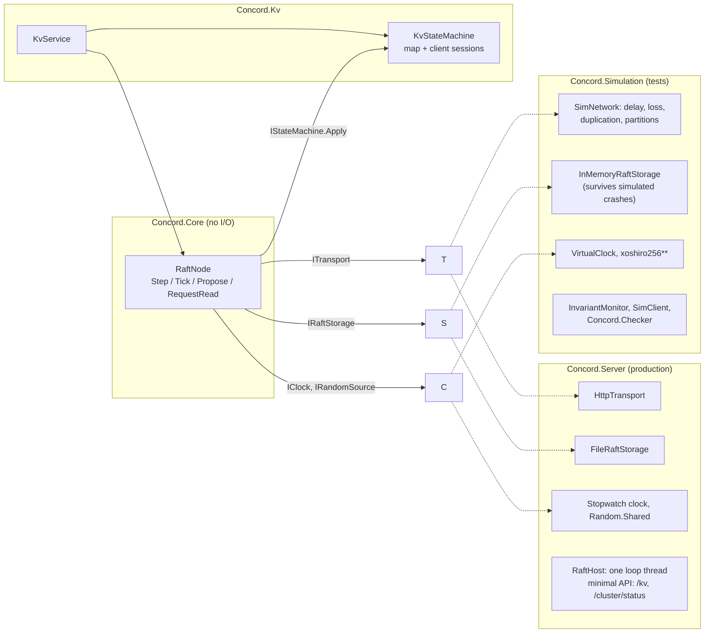

# Architecture

Concord is a key-value store replicated with Raft. The interesting part is not the store but how it is
tested: the same Raft code runs inside an HTTP server and inside a discrete-event simulator, and the
simulator can replay any failure from a 64-bit seed.

## Projects

| Project | Role |
|---|---|
| `Concord.Core` | Raft as a single-threaded state machine. Elections with pre-vote, check-quorum, log replication, snapshots, ReadIndex. Also the binary message codec. |
| `Concord.Kv` | The replicated state machine (put, get, delete, compare-and-set, per-client sessions) and `KvService`, which turns client requests into proposals and ReadIndex reads. |
| `Concord.Server` | One production node: ASP.NET Core minimal API, HTTP transport, file storage. |
| `Concord.Simulation` | Discrete-event simulator, faulty network, crash/restart, fault schedules, invariant monitor, client workload, timeline SVG. |
| `Concord.Checker` | Linearizability checker for KV histories. Has no dependency on the rest. |
| `Concord.Sim` | The `concord-sim` command line: seed sweeps, single-seed replay, timelines. |

## The Raft node

`RaftNode` never reads a clock, starts a thread, or touches a socket or file. The host calls it:

- `Step(message)` when a message arrives,
- `Tick()` at or after `NextDeadline` (the earliest election, heartbeat or check-quorum timer),
- `Propose(bytes)` and `RequestRead(callback)` on behalf of clients.

It answers only through the interfaces it was constructed with (`ITransport`, `IRaftStorage`,
`IStateMachine`, `IClock`, `IRandomSource`). Calls must not overlap. This is what lets one code base run
under a virtual clock in the simulator and a real one in the server.

The implementation follows the extended Raft paper (Ongaro and Ousterhout, 2014) and the thesis sections
it points to:

- **Elections.** Randomized timeouts in [min, max). A node first runs a pre-vote round (thesis 9.6): it
  asks whether it would win at term + 1 without changing its own term, so a node that was cut off cannot
  force a healthy leader to step down by inflating terms when it returns. Followers that heard from a
  leader within the minimum election timeout ignore vote requests. Unanswered vote requests are resent
  every heartbeat interval.
- **Check-quorum.** A leader that has not heard from a majority during an election timeout steps down,
  which bounds how long a partitioned leader keeps accepting requests.
- **Replication.** Each follower is in Probe (find the match point, one message at a time), Replicate
  (pipelined, optimistic `nextIndex`) or Snapshot state. Rejections carry the conflicting term and its first
  index so the leader skips a whole term per round trip. A follower never truncates on a matching entry,
  which makes duplicated and reordered `AppendEntries` harmless.
- **Commit.** The leader commits the highest index stored on a majority only if that entry is from its own
  term (paper, Figure 8). A new leader appends a no-op so earlier entries commit promptly.
- **Snapshots.** After `SnapshotThreshold` applied entries the node serializes the state machine and
  storage drops the log prefix. A follower that needs compacted entries gets `InstallSnapshot`; storage
  keeps any suffix that matches the snapshot (paper, section 7).

## Writes and reads

A write (`PUT`, `DELETE`, compare-and-set) becomes a `KvCommand` carrying `(clientId, sequence)`.
`KvService` registers a pending entry at the index the proposal will take, then proposes. When the entry
at that index is applied, the pending request completes if the term matches; if another leader's entry
landed there, or the node stops being leader first, the client gets "outcome unknown" and retries with the
same sequence number. The state machine keeps the last sequence and result per client, so the retry is
answered from the session instead of being applied twice (thesis 6.3).

Reads use ReadIndex (thesis 6.4) and never touch the log. The leader waits until it has committed an
entry in its current term, records its commit index, sends a heartbeat round tagged with a round number,
and waits for a majority to echo that round. Once the state machine has applied up to the recorded index,
the read is served from local state. A deposed leader cannot collect the acknowledgements, so it cannot
return stale data.

## The server

`RaftHost` owns the node and runs a loop over a channel of actions: incoming Raft batches, client
requests, status queries. Between actions it sleeps until `NextDeadline` and then calls `Tick`. Request
handlers await a `TaskCompletionSource` that the loop completes; continuations run asynchronously, so no
handler code runs on the loop thread.

`HttpTransport` keeps a bounded queue per peer (dropping the oldest message when full) and a pump that
POSTs batches to `/raft/messages` in the binary format from `RaftMessageCodec`. Lost or failed batches
are not retried; Raft's heartbeats and retransmissions recover.

`FileRaftStorage` writes three files: `hardstate` and `snapshot` are replaced atomically (temp file, fsync,
rename); `log` is append-only with length and CRC-32 per record, fsynced before each call returns.
Installing a snapshot writes the new log to `log.tmp`, then renames the snapshot into place (the commit
point), then renames the log. On start, a leftover `log.tmp` is rolled forward if the snapshot was
committed and discarded otherwise. A torn final record is cut off; a bad checksum anywhere else stops the
node, because silently dropping an acknowledged entry would violate Raft's guarantees.

## The simulator

`Simulator` is a priority queue of actions keyed by (virtual time, insertion sequence). There are no
threads and no wall-clock reads, so the order of events is a pure function of the inputs. Everything
random comes from one xoshiro256** generator seeded through SplitMix64; it is forked into independent
streams for the network, the fault schedule, the nodes' election timers and the clients, so changing the
workload does not reshuffle the faults.

`SimCluster` schedules each node's next wakeup at exactly `NextDeadline`, so virtual time jumps from
event to event and a 12-second run takes about 13 ms of CPU. A crash discards the `RaftNode` and its
state machine and bumps an incarnation number so timers and replies of the dead process are ignored;
`InMemoryRaftStorage` survives, modelling a disk whose writes were synced. A restart builds a new node
from that storage.

`SimNetwork` delivers each message after a uniform 1 to 8 ms (2% of messages take up to 80 ms, which
reorders them), and can drop, duplicate, partition nodes into groups, or cut one direction of a link.
Clients are never partitioned, so a client can keep talking to a leader that the other nodes have
abandoned.

`FaultInjector` draws a fault every 150 to 900 ms during the first part of the run: random two-way
splits, isolating the leader, one-way links, bursts of loss and duplication, crashes, restarts, and
quick crash-restart "bounces". Then it heals everything and restarts every node, and the cluster has to
recover before the run ends.

A run fails if:

1. the `InvariantMonitor` sees a broken safety property (two leaders in one term, a node voting twice in
   a term, two nodes applying different entries at one index, a new leader missing an applied entry, a
   commit index going backwards) or a node throws `RaftSafetyException`;
2. after the heal a client is still waiting, or the nodes have not applied the same prefix;
3. the clients' history is not linearizable.

## The linearizability checker

Each client operation is recorded with its call and return times (a global counter, so nothing ties),
its arguments and what the client saw. An operation the client gave up on is recorded with no return:
it may have taken effect at any point after its call, or never.

The checker is the Wing and Gong (1993) search with the memoization Lowe added (2017), the same
algorithm as Porcupine. Calls and returns form a doubly linked list in time order. The search repeatedly
takes the first call in the list, applies it to the sequential model, and if the recorded output is
legal removes the call and its return from the list ("lifts" it) and continues; reaching a return whose
call has not been linearized means the current order cannot work, so it backtracks. A cache of
(set of linearized operations, model state) pairs prunes states already explored. Operations that never
returned have their return at infinity, so they can always be placed last, which is the same as never
having happened.

Linearizability is local (Herlihy and Wing, 1990): a history is linearizable if and only if each object's
sub-history is. The KV history is split by key and each key is checked as a register with
compare-and-set, which keeps the search small. A search budget turns pathological cases into an
"inconclusive" verdict instead of a hang; none has occurred in the CI sweep.

## Injected bugs

Two deliberately broken behaviours can be switched on to show the harness catches real mistakes:

- `unsafe-reads`: leaders answer reads from local state without ReadIndex. Caught by the linearizability
  checker when a deposed leader serves a value that a newer leader has already overwritten.
- `ignore-log-votes`: votes are granted without the "candidate's log is at least as up-to-date" check.
  Caught by the invariant monitor as a Leader Completeness or State Machine Safety violation.

The README states how often each is caught. A third candidate, a node forgetting its vote on restart,
was not caught in 300 seeds by random faults and was removed rather than presented as covered; see the
roadmap.
